# Architecture – sinch-ai-bot-webhook

Detailed architecture of the Sinch AI bot call-log webhook service. Diagrams are written in [Mermaid](https://mermaid.js.org/) and render on Bitbucket/GitHub/VS Code (Markdown Preview Mermaid Support extension).

**Contents**

1. [Purpose and summary](#1-purpose-and-summary)
2. [Technology stack](#2-technology-stack)
3. [System context](#3-system-context)
4. [Component architecture](#4-component-architecture)
5. [Source layout and module responsibilities](#5-source-layout-and-module-responsibilities)
6. [End-to-end data flow](#6-end-to-end-data-flow)
7. [HTTP API](#7-http-api)
8. [Queues (BullMQ / Redis)](#8-queues-bullmq--redis)
9. [Input worker – processing logic](#9-input-worker--processing-logic)
10. [Validation and flattening](#10-validation-and-flattening)
11. [CSV generation and rotation](#11-csv-generation-and-rotation)
12. [SFTP upload](#12-sftp-upload)
13. [Reprocessing (failure and DLQ replay)](#13-reprocessing-failure-and-dlq-replay)
14. [Reliability guarantees](#14-reliability-guarantees)
15. [Redis keyspace](#15-redis-keyspace)
16. [Application lifecycle](#16-application-lifecycle)
17. [Logging and observability](#17-logging-and-observability)
18. [Configuration](#18-configuration)
19. [Deployment and infrastructure](#19-deployment-and-infrastructure)
20. [Testing](#20-testing)
21. [Security considerations](#21-security-considerations)
22. [Known limitations and design trade-offs](#22-known-limitations-and-design-trade-offs)

---

## 1. Purpose and summary

The service receives **call-log webhooks from the Sinch AI bot**, durably queues them, validates each record against the Data Extension schema, flattens valid records into **CSV files**, and uploads those files to an **SFTP server** (from where they are imported into the target Data Extension, e.g. Salesforce Marketing Cloud).

Design principles:

| Principle | How it is achieved |
| --- | --- |
| **Never lose a webhook** | `200` is returned only after jobs are persisted in Redis (AOF enabled). On enqueue failure the API returns `500` so Sinch can retry. |
| **Fast acknowledgement** | The HTTP handler does no validation – it only enqueues. Validation happens asynchronously in the worker. |
| **Bad data is isolated, not dropped** | Invalid records go to a *failure* report, exhausted/unrecoverable ones to a *DLQ* report; both are CSVs on SFTP and can be replayed. |
| **No duplicate rows** | Atomic Redis claim keyed on payload `id` (the Data Extension primary key) plus deterministic job ids for failure/DLQ hand-off. |
| **No overwritten / half-visible files on SFTP** | Upload to `.uploading` temp name, then rename to a *free* name. |
| **Survives restarts** | Leftover `.tmp`/`.csv` files are recovered and uploaded at startup; graceful shutdown flushes everything. |

## 2. Technology stack

| Layer | Technology |
| --- | --- |
| Runtime | Node.js >= 22.22.1, TypeScript ~5.9 (`tsx` for dev, `tsc` → `dist/` for prod) |
| HTTP | Express 4 |
| Queue | BullMQ 5 on Redis 7.2 (`ioredis`) |
| Queue dashboard | Bull Board (`@bull-board/express`) |
| File transfer | `ssh2-sftp-client` |
| Logging | Winston (JSON) + custom CloudWatch transport (`@aws-sdk/client-cloudwatch-logs`) |
| Config | `dotenv` (environment variables) |
| Tests | Node built-in test runner via `tsx --test` |
| Lint/format | ESLint 10 + typescript-eslint, Prettier |
| CI/CD | Bitbucket Pipelines → SSH deploy script on the server |
| Local infra | Docker Compose (Redis only) |

## 3. System context

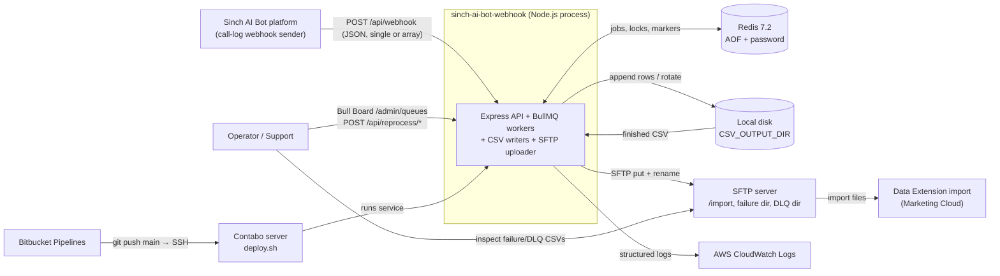

External dependencies and their failure impact:

| Dependency | Needed for | If unavailable |
| --- | --- | --- |
| Redis | Accepting webhooks, all queues, dedupe markers | App **refuses to start**; at runtime `/api/webhook` → `500`, `/api/health` → `503` |
| SFTP | Delivering CSVs | Files stay on local disk, retried with back-off and every `SFTP_FAILED_RETRY_INTERVAL_MS`, and at next startup. Webhook intake is unaffected |
| AWS CloudWatch | Log shipping (optional) | If configured but unreachable at startup → app **exits 1**; at runtime log batches are re-buffered and retried |
| Local disk | CSV staging | CSV write errors → input job retried, then DLQ |

## 4. Component architecture

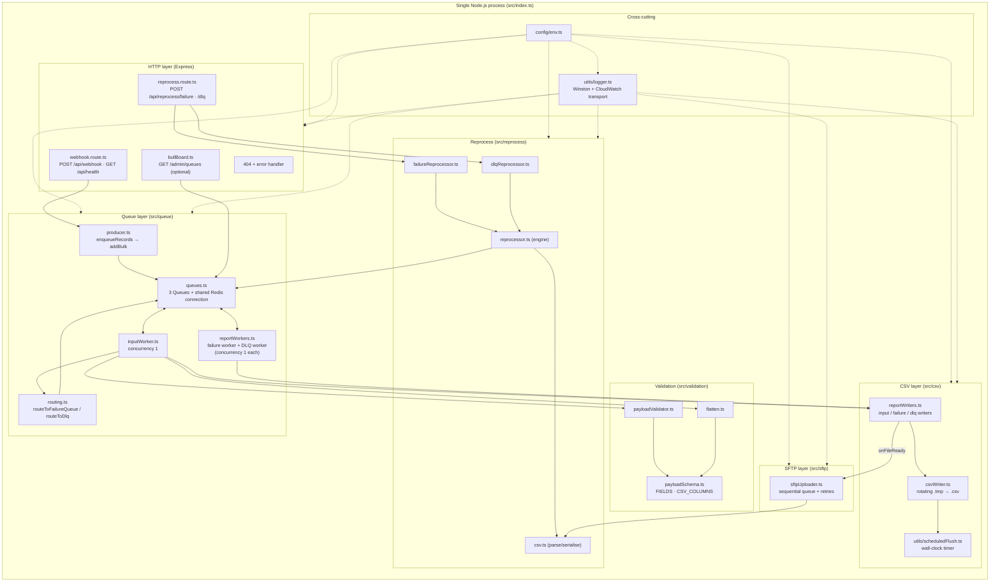

## 5. Source layout and module responsibilities

```
sinch-ai-bot-webhook/
├── src/
│   ├── index.ts                    Entry point: Express app, startup checks, worker start, graceful shutdown
│   ├── config/env.ts               Typed configuration from environment variables
│   ├── api/
│   │   ├── webhook.route.ts        POST /api/webhook, GET /api/health
│   │   ├── reprocess.route.ts      POST /api/reprocess/failure | /dlq
│   │   └── bullBoard.ts            Bull Board dashboard router
│   ├── queue/
│   │   ├── queues.ts               Queue names, Redis connection, 3 Queue instances, job defaults
│   │   ├── producer.ts             enqueueRecords() – bulk add to input queue
│   │   ├── inputWorker.ts          Validate → claim → flatten → write CSV; retry/DLQ logic
│   │   ├── routing.ts              Hand-off to failure queue / DLQ (deterministic job ids)
│   │   └── reportWorkers.ts        Consumers of failure and DLQ queues → CSV rows
│   ├── validation/
│   │   ├── payloadSchema.ts        FIELDS (single source of truth), CSV_COLUMNS
│   │   ├── payloadValidator.ts     Type / length / nullability checks
│   │   └── flatten.ts              Payload → CSV row (strings)
│   ├── csv/
│   │   ├── csvWriter.ts            Generic rotating CSV writer (.tmp → .csv)
│   │   └── reportWriters.ts        Three writer instances + column sets + startup recovery
│   ├── sftp/sftpUploader.ts        Sequential upload queue, retries, safe naming
│   ├── reprocess/
│   │   ├── reprocessor.ts          Shared replay engine
│   │   ├── failureReprocessor.ts   Spec for failure CSVs
│   │   ├── dlqReprocessor.ts       Spec for DLQ CSVs
│   │   └── csv.ts                  RFC 4180 parser / serialiser
│   └── utils/
│       ├── logger.ts               Winston logger, redaction, CloudWatch transport
│       └── scheduledFlush.ts       Wall-clock rotation scheduler (timezone aware)
├── tests/                          validator, flatten, reprocess-CSV tests + sample payload
├── Documents/                      Postman collection/environment (postmanCollection/), BRD, CSV schema
├── docker-compose.yml              Redis for local/dev
├── bitbucket-pipelines.yml         Deploy on push to main
├── .env.example                    All configuration variables
└── tsconfig.json, eslint.config.mjs, package.json
```

## 6. End-to-end data flow

### 6.1 Overview

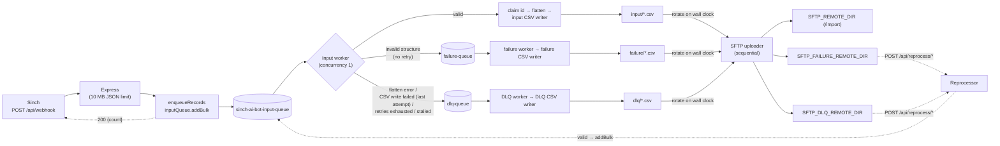

### 6.2 Happy-path sequence

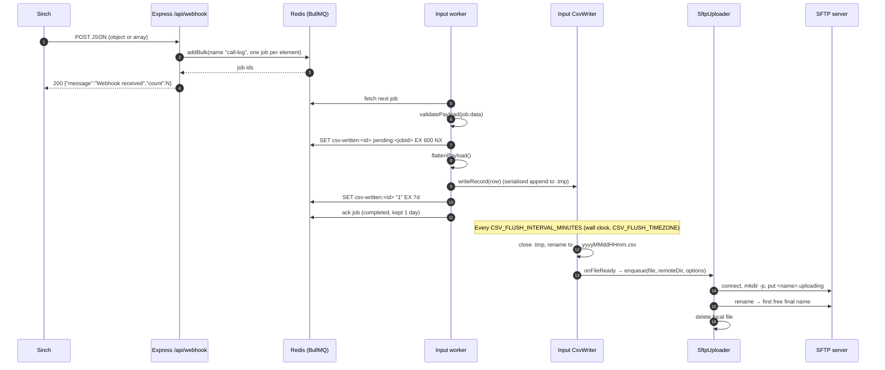

## 7. HTTP API

| Method & path | Purpose | Responses |
| --- | --- | --- |
| `POST /api/webhook` | Ingest call-log(s). Body is parsed as JSON **regardless of Content-Type**. An array = batch (one job per element); anything else = a single job. No validation here. | `200 {"message":"Webhook received","count":N}` after jobs are in Redis · `500 {"error":"Failed to queue webhook"}` (nothing accepted) · `400 {"error":"Invalid request body"}` for malformed JSON or a body over 10 MB (any 4xx from Express is mapped to 400) |
| `GET /api/health` | Redis liveness (`PING`) | `200 {"status":"ok","redis":"up"}` · `503 {"status":"degraded","redis":"down"}` |
| `POST /api/reprocess/failure` | Replay failure CSVs from SFTP. Optional body `{"fileName": "..."}` | `200` summary · `207` if any file failed · `400` bad fileName/not found · `409` run already in progress · `503` SFTP not configured · `500` |
| `POST /api/reprocess/dlq` | Same for DLQ CSVs | same as above |
| `GET {BULL_BOARD_PATH}` (default `/admin/queues`) | Bull Board UI for all three queues | Mounted only if `BULL_BOARD_ENABLED` (default **on** outside production, **off** in production) |
| anything else | – | `404 {"error":"Not found"}` |

Global error handler: 4xx errors → `400 {"error":"Invalid request body"}`; everything else is logged (`UNHANDLED_EXPRESS_ERROR`) and returned as `500`.

> The reprocess endpoints and Bull Board have **no authentication** (see [§21](#21-security-considerations)).

## 8. Queues (BullMQ / Redis)

Three queues share one `ioredis` connection (`maxRetriesPerRequest: null`, retry strategy `min(times*100, 3000) ms`).

| Queue | Name | Job name | Producer | Consumer | Completed retention | Failed retention |
| --- | --- | --- | --- | --- | --- | --- |
| Input | `sinch-ai-bot-input-queue` | `call-log` | webhook route, reprocessor | Input worker | 1 day | 7 days |
| Failure | `sinch-ai-bot-failure-queue` | `invalid-record` | Input worker (`routeToFailureQueue`) | Failure worker | removed on completion | kept (`removeOnFail:false`) |
| DLQ | `sinch-ai-bot-dlq-queue` | `dead-letter` | Input worker (`routeToDlq`) | DLQ worker | removed on completion | kept |

Default job options (all queues): `attempts = QUEUE_MAX_ATTEMPTS` (3), exponential back-off with base `QUEUE_RETRY_DELAY_MS` (2000 ms → 2 s, 4 s, …).

Why failure/DLQ jobs are removed on completion: they complete only after the CSV row is written, so removal on completion is exactly "row is persisted". A failed CSV write leaves the job in the queue for retry.

Hand-off job payloads:

```ts
FailureJobData { jobId, errors: string[], failedAt: ISO, originalPayload }
DlqJobData     { jobId, reason, attempts, failedAt: ISO, originalPayload }
```

Job ids: `failure_<inputJobId>` and `dlq_<inputJobId>` – BullMQ ignores an `add` with an existing id, so a repeated hand-off never produces a second report row.

## 9. Input worker – processing logic

`concurrency: 1` (serial processing keeps CSV ordering simple and the writer single-threaded).

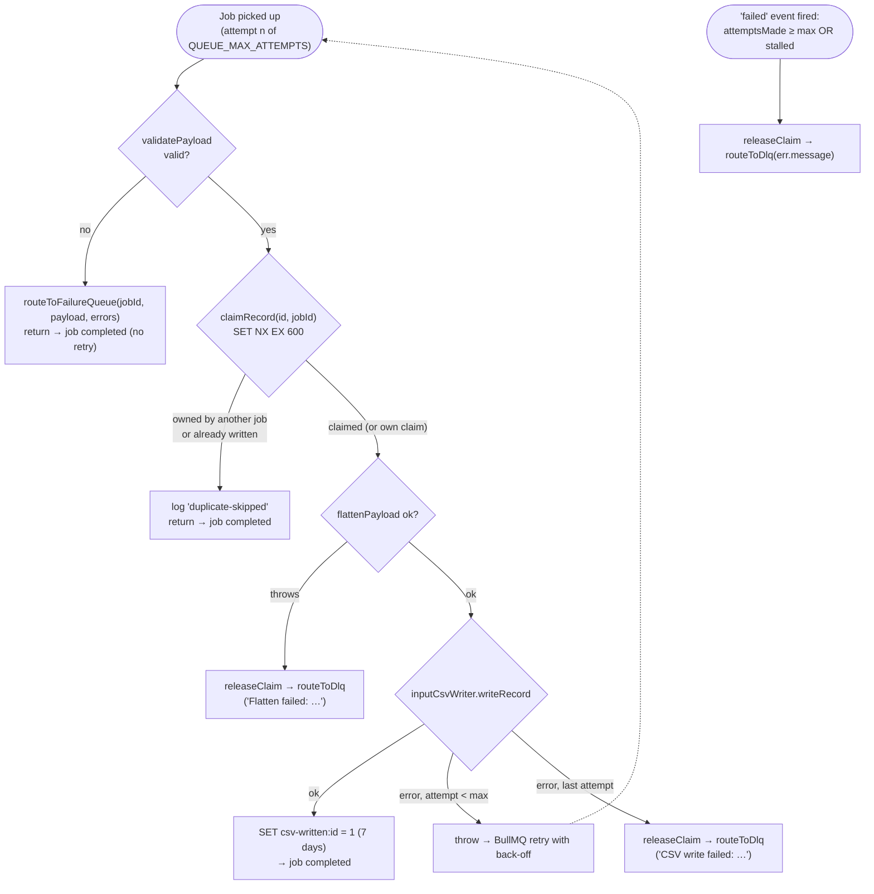

Key behaviours:

* **Acknowledgement rule** – a job is acknowledged only after its record is in the CSV or has been handed to the failure/DLQ queue.
* **Atomic claim** – `SET csv-written:<id> pending:<jobId> EX 600 NX`. If it exists, the job proceeds only if the value is *its own* claim (crash/stall re-run) or the key vanished. A successful write replaces the claim with `"1"` for 7 days. A Sinch **redelivery of the same call** (new BullMQ job id, same payload `id`) is therefore recognised and skipped.
* **Claim release** – via a Lua compare-and-delete script so one job can never delete another job's claim. Released when the job gives up, so a later DLQ replay is not mistaken for a duplicate.
* **`onFailed` fallback** – when retries are exhausted or the job stalled, the record is moved to the DLQ. If even the DLQ hand-off fails, the job remains in the input queue's *failed* set (7 days) and can be retried from Bull Board.
* **Marker write failure** is only a warning (`MARKER_SET_FAILED`); the row is already written.

## 10. Validation and flattening

[payloadSchema.ts](../../src/validation/payloadSchema.ts) defines `FIELDS` – the single source of truth for validation, flattening and the CSV header (39 columns, in this order):

| Type | Fields |
| --- | --- |
| **text** (with max length) | `id`(100, **required**), `contact_name`(200), `contact_id`(100), `campaign_name`(200), `duration`(20), `bot_name`(200), `call_type`(50), `recording_url`(500), `transcript_url`(500), `disposition`(200), `disposition_criticality`(50), `next_actions`(500), `next_action_status`(50), `call_summary`(4000), `call_ended_reason`(100), `contacts_audience_name`(200), `sub_disposition`(200), `campaign_group_name`(200), `bot_id`(50), `campaign_id`(100), `contact_phone`(20), `campaign_group_id`(100), `customer_id`(100), `call_id`(100), `vin_number`(50), `dealer_region`(50), `coms_id`(100) |
| **date** (string, `Date.parse`-able) | `call_start_time`, `created_at`, `updated_at` |
| **boolean** | `next_retry_scheduled`, `call_connected`, `call_engaged`, `call_transferred` |
| **number** (finite) | `call_attempt_number`, `unix_call_time`, `call_duration` |
| **array** | `all_dispositions` |
| **json** (any) | `extracted_additional_details` |

Validation rules ([payloadValidator.ts](../../src/validation/payloadValidator.ts)):

* Payload must be a plain JSON object (arrays/primitives → failure queue with `Payload must be a JSON object`).
* `id` is required (non-null, non-blank). All other fields may be absent/`null`; if present they must have the right type and, for text, fit `maxLength`.
* Unknown keys are ignored (not copied to CSV).
* `array`/`json` fields are **never rejected for size** – truncating would corrupt the JSON, and refusing a valid call because of many dispositions would send good data to the failure queue.

Flattening ([flatten.ts](../../src/validation/flatten.ts)): absent/null → empty string; `array`/`json` → JSON text (strings kept as-is); everything else → `String(value)` (booleans become `true`/`false`; dates written as received).

## 11. CSV generation and rotation

Three independent `CsvWriter` instances ([reportWriters.ts](../../src/csv/reportWriters.ts)):

| Report | Local dir | File prefix | Columns | SFTP destination |
| --- | --- | --- | --- | --- |
| input | `CSV_OUTPUT_DIR/input/` | `sinch_ai_bot_webhook_input` | 39 (`CSV_COLUMNS`); +leading `filename` column (=40) on the SFTP copy | `SFTP_REMOTE_DIR` (`/import`) |
| failure | `CSV_OUTPUT_DIR/failure/` | `sinch_ai_bot_webhook_failure` | `JobId, Reason, FailedAt, RawPayload, coms_id` | `SFTP_FAILURE_REMOTE_DIR` |
| dlq | `CSV_OUTPUT_DIR/dlq/` | `sinch_ai_bot_webhook_dlq` | `JobId, Reason, Attempts, FailedAt, RawPayload, coms_id` | `SFTP_DLQ_REMOTE_DIR` |

Writer mechanics ([csvWriter.ts](../../src/csv/csvWriter.ts)):

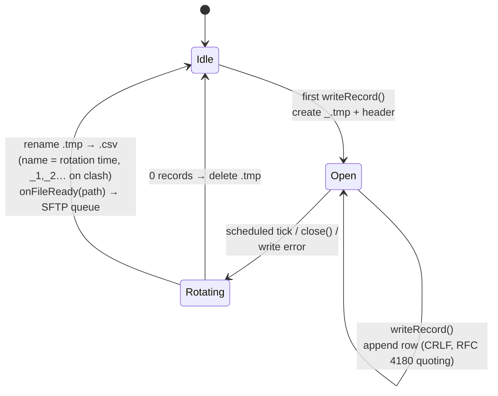

* All operations are serialised through a promise chain (`enqueue`) – no interleaved writes, rotation never races a write.
* **Rotation is wall-clock based**, not "N minutes after start": `ScheduledFlushTimer` computes the next boundary in `CSV_FLUSH_TIMEZONE` (default `Asia/Kolkata`) – e.g. 30-min interval → :00 and :30. `CSV_FLUSH_INTERVAL_MINUTES` must divide 1440 (15, 30, 60, …) or **startup fails**. The timer is `unref()`ed and skips overlapping firings.
* File name: `sinch_ai_bot_webhook_<report>_<yyyyMMddHHmm>.csv` – timestamp is the *rotation* time. Open file is `.tmp`.
* A write error rotates the file immediately (so rows already written are not stranded) and re-throws, which makes the input job retry.
* Empty files are discarded.
* **Recovery:** at startup `scanPendingFiles()` renames orphan `.tmp` files to `.csv` and returns every `.csv` in the dir; they are all enqueued for upload.

## 12. SFTP upload

[sftpUploader.ts](../../src/sftp/sftpUploader.ts) – a single in-process FIFO queue processed **sequentially** (one file at a time, one SFTP connection per attempt).

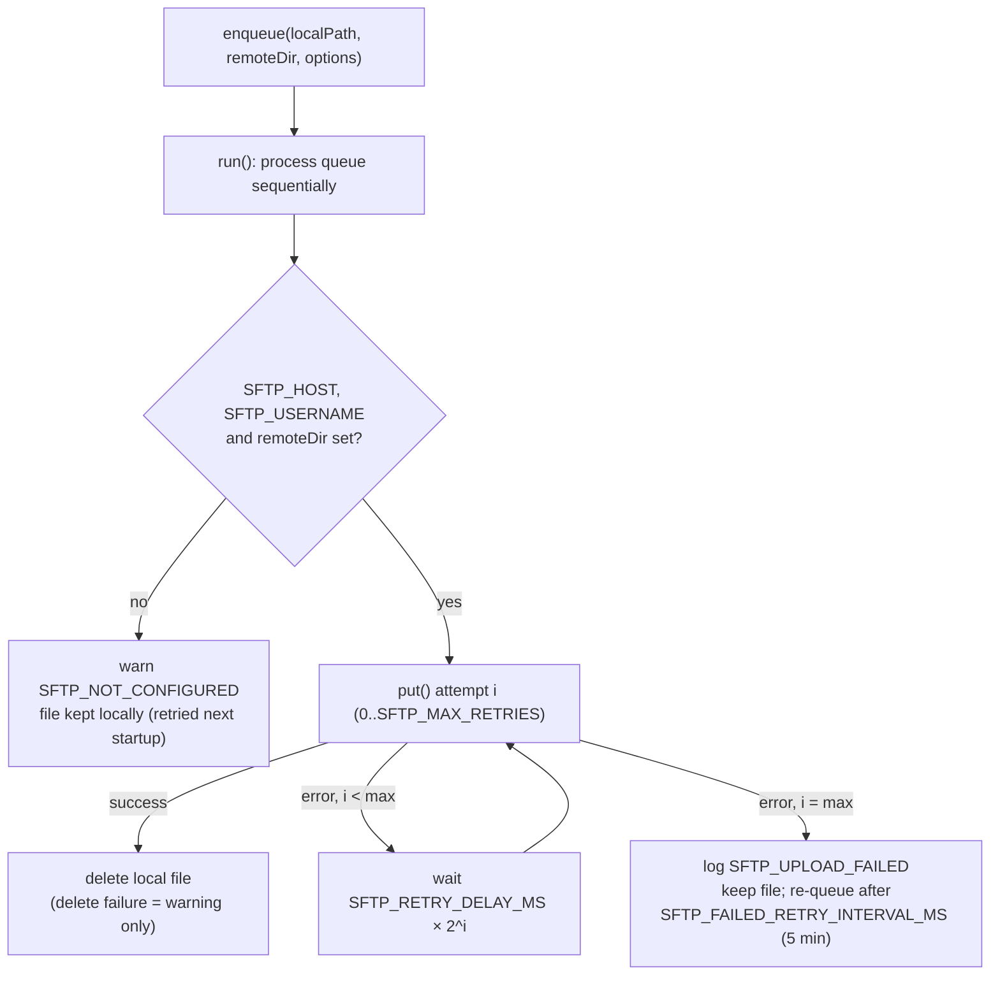

`put()` – safe naming protocol:

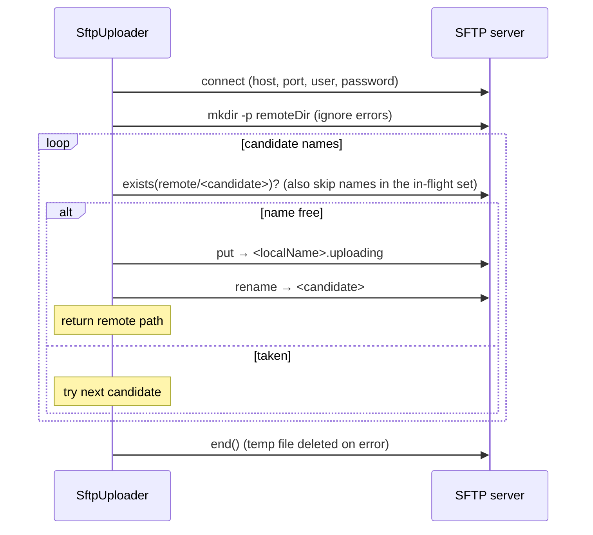

Candidate names:

* **Input report** (has `defaultName`): `sinch_ai_bot_webhook_input.csv` → `sinch_ai_bot_webhook_input_<yyyyMMddHHmm upload time>.csv` → `…_1`, `…_2`, … (max 1000).
* **Failure/DLQ**: the local file name → local name `_1`, `_2`, …
* The input upload is **re-serialised per candidate**: a `filename` column is prepended holding the final remote name (no `.csv`) on every row, so the file content always matches its final name. The local copy is untouched (39 columns).
* Existing remote files are **never overwritten**; a half-written file is never visible under its final name.
* The local file is deleted only after a successful upload.

## 13. Reprocessing (failure and DLQ replay)

Operators can replay records captured in failure/DLQ CSVs on SFTP back through the input queue.

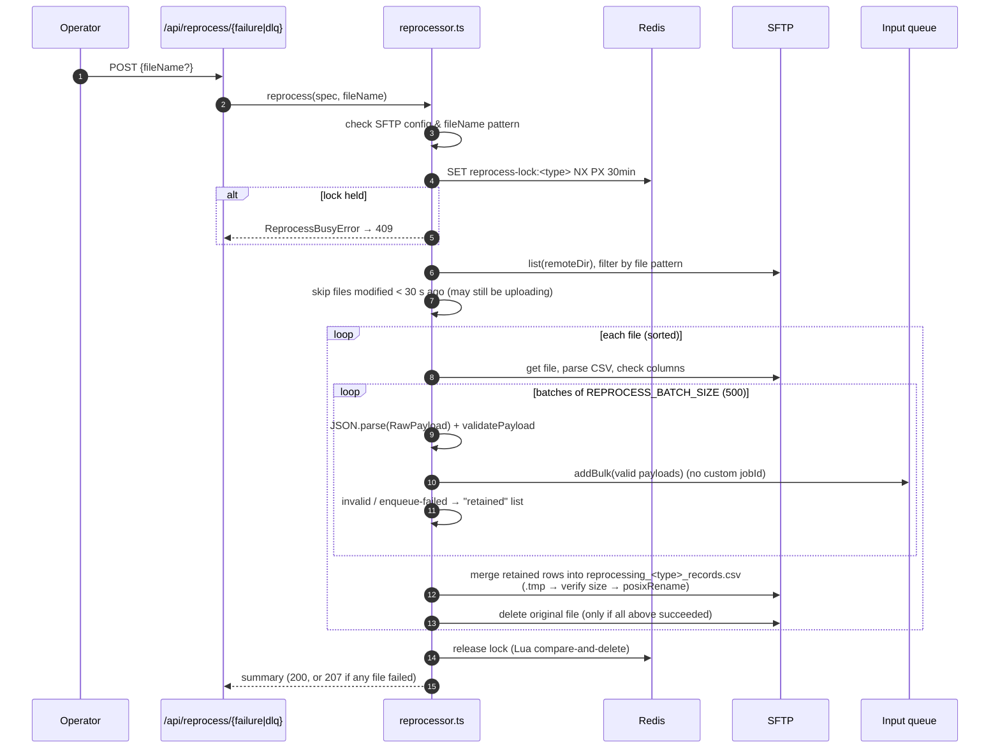

* File patterns: `sinch_ai_bot_webhook_failure_*.csv`, `sinch_ai_bot_webhook_dlq_*.csv` (alphanumeric/underscore). Output (still-invalid) collection files: `reprocessing_failure_records.csv`, `reprocessing_dlq_records.csv` (de-duplicated by `JobId`).
* **Idempotent re-runs:** any failure leaves the original in place; the input worker skips already-written payload ids and the retained CSV is de-duplicated, so running again is safe.
* No custom `jobId` is used when re-queueing because BullMQ would silently ignore an existing id and the record would be counted as queued while being dropped.
* Older files without the `coms_id` column remain replayable.

Summary JSON: `{ type, filesFound, filesProcessed, filesFailed, totalRecords, queued, invalid, enqueueFailed, files:[{file,status,totalRecords,queued,invalid,enqueueFailed,alreadyRetained,originalDeleted,error?}] }`.

## 14. Reliability guarantees

| Scenario | Behaviour |
| --- | --- |
| Redis down when webhook arrives | `500`; nothing accepted → sender retries |
| Process crash after `200` | Jobs are in Redis (AOF); the worker resumes them after restart |
| Worker crash mid-job | Job stalls → BullMQ re-runs it; own `pending:<jobId>` claim lets it proceed; if stalled out, moved to DLQ |
| Duplicate delivery of the same `id` | Skipped via `csv-written:<id>` (7 days) |
| Invalid payload | Failure queue → failure CSV (no retries) |
| Transient CSV write error | Input job retried (exponential back-off); DLQ on last attempt |
| Unflattenable record | DLQ immediately |
| Redis hand-off to failure/DLQ fails | Job stays in input *failed* set for 7 days (visible in Bull Board) |
| SFTP unreachable | In-process retries (exp. back-off) → file kept → re-queued every 5 min → re-uploaded at next start |
| SFTP name collision | Next free name; never overwrite |
| Crash with open `.tmp` | Recovered and uploaded at next startup |
| SIGINT / SIGTERM | Orderly drain (see §16) |

**Delivery semantics:** at-least-once into the pipeline, de-duplicated by payload `id` for the 7-day marker window; the Data Extension primary key (`id`) is the final backstop.

## 15. Redis keyspace

| Key / pattern | Type | TTL | Purpose |
| --- | --- | --- | --- |
| `bull:sinch-ai-bot-input-queue:*` | BullMQ structures | per retention | Input queue |
| `bull:sinch-ai-bot-failure-queue:*` | BullMQ structures | – | Failure queue |
| `bull:sinch-ai-bot-dlq-queue:*` | BullMQ structures | – | DLQ queue |
| `sinch-ai-bot-webhook:csv-written:<recordId>` | string | `pending:<jobId>` = 10 min; `1` = 7 days | Claim / written marker (dedupe) |
| `sinch-ai-bot-webhook:reprocess-lock:<failure\|dlq>` | string (UUID token) | 30 min | One reprocess run per type |

## 16. Application lifecycle

### Startup ([index.ts](../../src/index.ts))

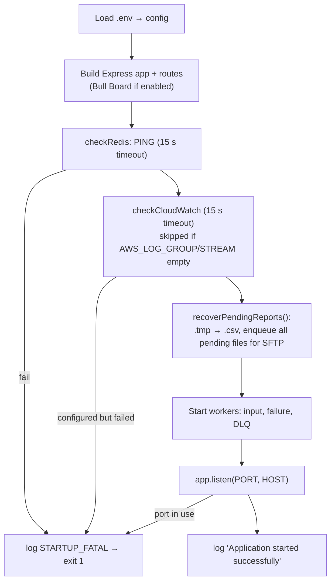

Also at import time: `CSV_FLUSH_INTERVAL_MINUTES` is validated (invalid → startup fails).

### Graceful shutdown (`SIGINT`/`SIGTERM`, repeated signals ignored)

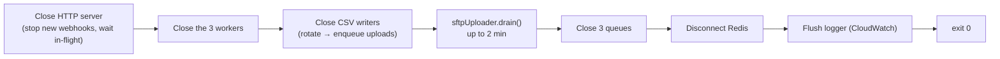

## 17. Logging and observability

* **Winston JSON logs** to console; each entry carries `timestamp, service, hostname, environment, component, status, severity, tags` plus level-specific fields (`error_code`, `warning_code`, `stack_trace`, `retry_count`, `duration_ms`, trace/correlation ids).
* **Redaction:** keys such as `password`, `secret`, `token`, `authorization`, `api_key`, AWS keys are replaced with `[REDACTED]` (recursively, depth ≤ 6); secret-looking strings (AWS key ids, `password=…`) are scrubbed from messages.
* **Event model:** every entry has a stable `event` (`<domain>.<action>`, catalogue in `src/utils/logEvents.ts`), a derived `category`, and flat typed fields (`job_id`, `file_id`, `file_name`, `record_count`, `attempt`, …) instead of values embedded in the message. `boot_id` + `log_seq` number each process run's entries so readers can deduplicate and detect gaps.
* **CloudWatch transport** (optional, enabled when `AWS_LOG_GROUP` and `AWS_LOG_STREAM` are set): buffers events (capped at 10,000; the oldest are dropped and later reported as a `logger.events_dropped` entry), flushes every 2 s or at 100 events in batches within the PutLogEvents limits (10,000 events / ~1 MB), one flush at a time, sorted by the entry's own timestamp. Creates the log stream if missing; a stream that failed to initialise is retried every 30 s and nothing is sent to it meanwhile. Transient `PutLogEvents` failures re-buffer the batch; `InvalidParameterException` drops it. Entries over ~200 KB are shrunk to their identifying fields. Uses explicit keys if provided, otherwise the default AWS credential chain.
* **Level:** `production` is fixed at `info` and disables debug; otherwise `LOG_LEVEL`.
* **Notable error/warning codes:** `ENQUEUE_FAILED`, `INPUT_JOB_FAILED`, `INPUT_WORKER_ERROR`, `DLQ_HANDOFF_FAILED`, `MOVED_TO_DLQ`, `INVALID_PAYLOAD`, `MARKER_SET_FAILED`, `REPORT_JOB_FAILED`, `REPORT_WORKER_ERROR`, `CSV_ROTATION_FAILED`, `CSV_STREAM_ERROR`, `SFTP_UPLOAD_FAILED`, `SFTP_UPLOAD_RETRY`, `SFTP_NOT_CONFIGURED`, `SFTP_DRAIN_TIMEOUT`, `LOCAL_DELETE_FAILED`, `REPROCESS_FAILED`, `REPROCESS_FILE_FAILED`, `REPROCESS_ENQUEUE_FAILED`, `REPROCESS_FILE_NOT_SETTLED`, `REDIS_ERROR`, `QUEUE_ERROR`, `STARTUP_FATAL`.
* **Dashboards:** Bull Board for queue depth/failed jobs; `GET /api/health` for liveness probes.

## 18. Configuration

All settings are environment variables loaded by [env.ts](../../src/config/env.ts) (template: [.env.example](../../.env.example)).

| Group | Variable | Default | Notes |
| --- | --- | --- | --- |
| Server | `NODE_ENV` | `development` | `production` fixes log level `info`, disables Bull Board by default |
| | `PORT` / `HOST` | `3000` / `0.0.0.0` | |
| Redis | `REDIS_URL` | `redis://localhost:4001` | |
| | `REDIS_PASSWORD` | – | Must match `docker-compose` / server Redis |
| Dashboard | `BULL_BOARD_ENABLED` | on unless production | No auth |
| | `BULL_BOARD_PATH` | `/admin/queues` | |
| Queue | `QUEUE_MAX_ATTEMPTS` | `3` | Attempts before DLQ |
| | `QUEUE_RETRY_DELAY_MS` | `2000` | Exponential base |
| CSV | `CSV_OUTPUT_DIR` | `./csv_output` | `input/`, `failure/`, `dlq/` subfolders |
| | `CSV_FLUSH_INTERVAL_MINUTES` | `30` | Must divide 1440 |
| | `CSV_FLUSH_TIMEZONE` | `Asia/Kolkata` | Rotation clock and file-name stamps |
| SFTP | `SFTP_HOST`, `SFTP_PORT`, `SFTP_USERNAME`, `SFTP_PASSWORD` | –, `22`, –, – | Upload skipped until host+user+dir set |
| | `SFTP_REMOTE_DIR` | `/import` | Input CSV destination |
| | `SFTP_FAILURE_REMOTE_DIR`, `SFTP_DLQ_REMOTE_DIR` | empty | Upload skipped when empty |
| | `SFTP_MAX_RETRIES` | `5` | Retries *after* first attempt |
| | `SFTP_RETRY_DELAY_MS` | `2000` | Exponential base |
| | `SFTP_FAILED_RETRY_INTERVAL_MS` | `300000` | Re-queue interval after retries exhausted |
| Reprocess | `REPROCESS_BATCH_SIZE` | `500` | Records per `addBulk` |
| Logging | `LOG_LEVEL` | `info` | Outside production |
| AWS | `AWS_ACCESS_KEY_ID`, `AWS_SECRET_ACCESS_KEY` | – | Optional (default chain) |
| | `AWS_REGION` | `ap-south-1` | |
| | `AWS_LOG_GROUP`, `AWS_LOG_STREAM` | – | Both required to enable CloudWatch |

## 19. Deployment and infrastructure

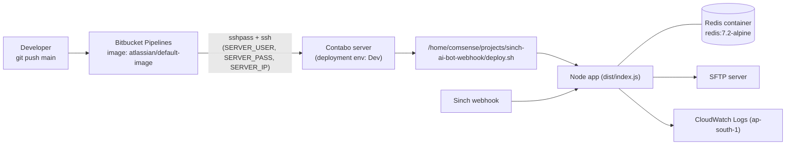

* **Pipeline** ([bitbucket-pipelines.yml](../../bitbucket-pipelines.yml)): on push to `main`, a single step "Deploy to Internal Contabo" SSHes into the server and executes `deploy.sh` (the script itself lives on the server, not in this repo). Secrets come from Bitbucket repository variables.
* **Redis** ([docker-compose.yml](../../docker-compose.yml)): `redis:7.2-alpine`, container `sinch_ai_bot_webhook_redis`, host port **4112** → 6379, named volume for `/data`, `--appendonly yes` (durability), `--requirepass ${REDIS_PASSWORD}` (compose refuses to start without it), `redis-cli ping` health check, bridge network `webhook_network`.
* **Build/run:** `npm run build` (`tsc` → `dist/`), `npm start` (`node dist/index.js`). The app is a single instance; the Redis-backed claim also makes multiple instances safe for deduplication, but each instance would write its own CSVs and upload them independently (see §22).

> Note: `.env.example` and the README use Redis host port `4001`, while `docker-compose.yml` publishes `4112`. Keep `REDIS_URL` consistent with whichever mapping is actually in use.

## 20. Testing

**Unit tests** (`npm test`, no Redis/network required) in [tests/](../../tests/):

| File | Covers |
| --- | --- |
| `payloadValidator.test.ts` | required `id`, types, lengths, nullability, non-object payloads |
| `flatten.test.ts` | null/absent → empty, JSON fields, booleans, column order |
| `reprocessCsv.test.ts` | RFC 4180 parse/serialise round-trips (quotes, commas, line breaks, BOM) |
| `samplePayload.ts` | Reference payload used by tests |

**Postman:** `Documents/postmanCollection/` contains the collection `Sinch_AI_Bot_Webhook` and a `Local` environment.

## 21. Security considerations

| Area | Current state | Recommendation |
| --- | --- | --- |
| Webhook authentication | None in code – any caller who can reach the port can enqueue | Restrict at network/reverse-proxy level (IP allow-list) or add a shared-secret/signature check |
| Bull Board | No auth; can retry/delete jobs; off by default in production | Keep disabled in production or protect behind VPN/proxy auth |
| Reprocess endpoints | No auth; can move data between SFTP and the queue | Same as above |
| Secrets | Via env vars; redacted in logs | Do not commit `.env`; use a secret store on the server |
| SFTP | Password authentication | Prefer key-based auth and host-key pinning |
| Transport | App serves plain HTTP | Terminate TLS at a proxy / load balancer |
| Payload size | 10 MB JSON limit | Adequate; tune if batches grow |
| PII | Payloads include contact name/phone and call data; raw payloads are stored in failure/DLQ CSVs and Redis job data | Apply retention and access controls on SFTP dirs and Redis |
| Pipeline | Uses `sshpass` with `StrictHostKeyChecking=no` | Move to SSH keys and a pinned host key |

## 22. Known limitations and design trade-offs

* **Single-consumer throughput:** the input worker runs with `concurrency: 1` and one serial CSV writer; ingest speed (HTTP → Redis) is much higher than drain speed, so backlog grows under sustained bursts.
* **Single-instance CSV model:** each instance has its own local CSV dir and SFTP uploader. Running multiple instances would produce multiple files per interval (names collide-safe thanks to the free-name protocol) but dedupe still holds via Redis.
* **Dedupe window:** 7 days via `csv-written:<id>`; beyond that the Data Extension primary key is the safeguard.
* **Batch semantics:** an array webhook is split into independent jobs; a failure of one element does not affect the others.
* **Validation is asynchronous:** Sinch always gets `200` for well-formed JSON even if records are later routed to the failure queue.
* **SFTP upload queue is in memory:** pending uploads are not persisted in Redis; they survive restarts only because the CSV files stay on disk and are re-scanned at startup.
* **`deploy.sh` is outside the repo:** deployment behaviour (build, restart, process manager) is not version-controlled here.
