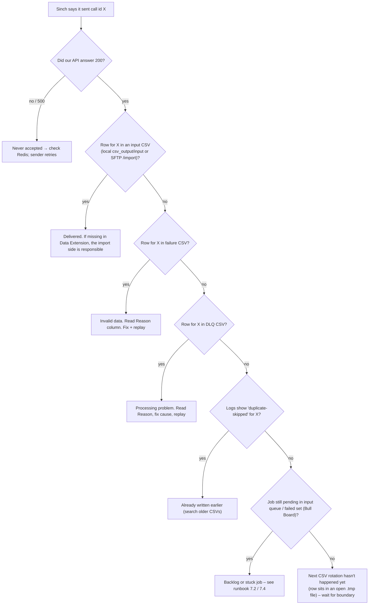

# Developer Guide – sinch-ai-bot-webhook

Complete hand-over document for developers who will run, support or extend this service. It explains **what the service does, how it works internally, how every kind of error is handled, and what to do when something goes wrong.**

Companion document: [ARCHITECTURE.md](ARCHITECTURE.md) (diagrams, component map, Redis keyspace, deployment, security). This guide is the practical "how do I work with it" manual; read both.

**Contents**

1. [What the service does](#1-what-the-service-does)
2. [Quick start (local)](#2-quick-start-local)
3. [How it works – the 5-minute version](#3-how-it-works--the-5-minute-version)
4. [The webhook contract](#4-the-webhook-contract)
5. [Detailed processing walk-through](#5-detailed-processing-walk-through)
6. [Error handling – complete reference](#6-error-handling--complete-reference)
7. [Operations runbook (what to do when…)](#7-operations-runbook-what-to-do-when)
8. [Monitoring and logs](#8-monitoring-and-logs)
9. [Replaying failed records](#9-replaying-failed-records)
10. [Configuration reference](#10-configuration-reference)
11. [Output files: CSV formats and naming](#11-output-files-csv-formats-and-naming)
12. [Extending the service](#12-extending-the-service)
13. [Testing](#13-testing)
14. [Build, deploy and release](#14-build-deploy-and-release)
15. [Code conventions](#15-code-conventions)
16. [Glossary](#16-glossary)
17. [FAQ and gotchas](#17-faq-and-gotchas)

---

## 1. What the service does

Sinch's AI voice bot calls customers (Royal Enfield use case) and, after each call, sends a **call-log webhook**. This service:

1. **Accepts** the webhook and stores it durably in a Redis-backed queue (acknowledging Sinch immediately).
2. **Validates** each call record against the Data Extension schema (types, lengths, required `id`).
3. **Writes** valid records as rows of a **CSV file**; bad records go to separate **failure** / **DLQ** CSVs instead of being dropped.
4. **Rotates** the CSV files on a wall-clock schedule (default every 30 min) and **uploads** them to **SFTP**, where an import job loads them into the Marketing Cloud Data Extension.

```
Sinch ──POST──► API ──► [input queue] ──► worker ──valid──► input CSV ───┐
                                             │                           │ rotate every N min
                                             ├─invalid─► [failure queue] ► failure CSV ──┤
                                             └─gave up─► [dlq queue] ────► DLQ CSV ──────┤
                                                                                         ▼
                                                                              SFTP (/import, failure dir, DLQ dir)
```

**Golden rules the code is built around**

* A webhook is only acknowledged (`200`) once it is safely in Redis.
* A queue job is only completed once its record is in a CSV file **or** has been handed to the failure/DLQ queue. Nothing is silently dropped.
* A local CSV file is only deleted after it is safely on SFTP. A remote file is never overwritten.
* The same call (`id`) is written to the input CSV at most once (7-day window).

## 2. Quick start (local)

**Prerequisites:** Node.js >= 22.22.1, Docker (for Redis), npm.

```bash
npm install
cp .env.example .env          # then edit – see below
docker compose up -d          # Redis 7.2 (AOF, password)
npm run dev                   # http://localhost:3000
```

Minimum `.env` for local development:

```ini
REDIS_URL=redis://localhost:4112     # docker-compose.yml publishes host port 4112 (the README/.env.example say 4001 – use the port that matches your Redis)
REDIS_PASSWORD=choose-a-password     # docker compose refuses to start without it; must match
SFTP_HOST=                           # leave empty to skip uploads – CSVs stay in ./csv_output
```

Smoke-test it:

```bash
# health
curl http://localhost:3000/api/health
# -> {"status":"ok","redis":"up"}

# send one record (minimal valid payload: only "call_id" is required)
curl -X POST http://localhost:3000/api/webhook \
  -H "Content-Type: application/json" \
  -d '{"call_id":"test-001","contact_name":"Test User","call_connected":true,"call_duration":42}'
# -> {"message":"Webhook received","count":1}

# send a batch (array = one job per element)
curl -X POST http://localhost:3000/api/webhook -H "Content-Type: application/json" \
  -d '[{"call_id":"a1"},{"call_id":"a2"},{"call_duration":42}]'
# -> count 3; a1 and a2 -> input CSV, the third -> failure CSV ("call_id is required")
```

Watch the queues at <http://localhost:3000/admin/queues> (Bull Board, on by default outside production). CSV files appear under `csv_output/input|failure|dlq/` as `.tmp` while open, and become `.csv` at the next rotation boundary (e.g. :00 / :30 in `Asia/Kolkata`). To see a rotation quickly, set `CSV_FLUSH_INTERVAL_MINUTES=15` (or `1`; the value must divide 1440) and wait for the next boundary, or stop the app with Ctrl+C – shutdown rotates all open files.

Ready-made requests: import `Documents/postmanCollection/Sinch_AI_Bot_Webhook.postman_collection.json` and `Local.postman_environment.json` into Postman. A full valid sample payload is in [tests/samplePayload.ts](../../tests/samplePayload.ts).

Useful scripts:

| Command | Purpose |
| --- | --- |
| `npm run dev` / `dev:watch` | Run with tsx (watch = restart on change) |
| `npm run build` / `npm start` | Compile to `dist/` / run compiled build |
| `npm test` | Unit tests (no Redis/network needed) |
| `npm run lint` / `npm run format` | ESLint / Prettier on `src` |

## 3. How it works – the 5-minute version

There is **one Node.js process** containing everything:

| Part | What it is | Source |
| --- | --- | --- |
| API | Express: webhook intake, health, reprocess, Bull Board | [src/api](../../src/api) |
| Queues | 3 BullMQ queues on one Redis connection | [src/queue/queues.ts](../../src/queue/queues.ts) |
| Input worker | Validates and writes rows; decides success / failure / DLQ | [src/queue/inputWorker.ts](../../src/queue/inputWorker.ts) |
| Failure & DLQ workers | Turn hand-off jobs into report CSV rows | [src/queue/reportWorkers.ts](../../src/queue/reportWorkers.ts) |
| CSV writers | Append rows to `.tmp`, rotate to `.csv` on a clock | [src/csv](../../src/csv) |
| SFTP uploader | Sequential in-memory upload queue with retries | [src/sftp/sftpUploader.ts](../../src/sftp/sftpUploader.ts) |
| Reprocessor | Replays failure/DLQ CSVs from SFTP into the input queue | [src/reprocess](../../src/reprocess) |
| Logger | Winston JSON + optional CloudWatch | [src/utils/logger.ts](../../src/utils/logger.ts) |

Three **kinds of outcome** exist for every record:

| Outcome | Trigger | Where it ends up | Retried? |
| --- | --- | --- | --- |
| **Success** | Valid and written | `input` CSV → `SFTP_REMOTE_DIR` | – |
| **Failure** | Payload is *structurally invalid* (not an object, missing `id`, wrong type, text too long) | `failure` CSV → `SFTP_FAILURE_REMOTE_DIR` | **No** – retrying cannot fix bad data |
| **DLQ** (dead letter) | *Processing* problem: flatten threw, CSV write kept failing, retries exhausted, job stalled | `dlq` CSV → `SFTP_DLQ_REMOTE_DIR` | Retried `QUEUE_MAX_ATTEMPTS` times first (except flatten errors, which go straight to DLQ) |

The distinction matters when supporting: **failure = fix the data / sender; DLQ = fix the system, then replay.**

## 4. The webhook contract

`POST /api/webhook` – body is parsed as JSON **whatever `Content-Type` the sender uses** (so a mislabelled `text/plain` body still works). Max body **10 MB**.

* A **JSON object** → 1 job. A **JSON array** → 1 job per element (elements are independent).
* **No validation at the API.** Sinch gets `200` for any parseable JSON. Do not use the HTTP status to judge data quality – check the failure CSV.
* Empty array `[]` → `200 {"count":0}`.

| Response | Meaning | Sender should |
| --- | --- | --- |
| `200 {"message":"Webhook received","count":N}` | All N jobs are in Redis | Nothing |
| `400 {"error":"Invalid request body"}` | Malformed JSON, or body > 10 MB | Fix and resend (retrying unchanged will fail again) |
| `500 {"error":"Failed to queue webhook"}` | Redis rejected the enqueue; **nothing from this request was accepted** | Retry later |

Schema (39 fields; only `id` is required). Authoritative definition: [payloadSchema.ts](../../src/validation/payloadSchema.ts). Also see `Documents/csv_schema.csv` / `.xlsx` and the BRD in `Documents/Client Documentation`.

Rules per field type:

| Type | Accepted | Rejected with message |
| --- | --- | --- |
| text | string, length ≤ `maxLength`; `call_id` must be non-blank | `<f> must be a string` · `<f> exceeds N characters` · `call_id must not be empty` |
| date | string that `Date.parse` accepts | `<f> must be a date string` |
| boolean | `true`/`false` (not `"true"`) | `<f> must be a boolean` |
| number | finite JSON number (not `"42"`) | `<f> must be a number` |
| array | JSON array | `<f> must be an array` |
| json | anything | – |
| any | `null` / absent is OK (empty cell), except `call_id` | `call_id is required` |

Unknown keys are ignored (not stored). Multiple errors on one record are joined with `; ` in the failure CSV `Reason` column.

## 5. Detailed processing walk-through

### 5.1 Intake
[webhook.route.ts](../../src/api/webhook.route.ts) wraps a non-array body in an array and calls `enqueueRecords` → `inputQueue.addBulk(...)`. Each job: name `call-log`, `data` = the raw record, `attempts` = `QUEUE_MAX_ATTEMPTS`, exponential back-off from `QUEUE_RETRY_DELAY_MS`. BullMQ generates the job id (numeric).

### 5.2 Input worker (`concurrency: 1`)
For every job, [processJob](../../src/queue/inputWorker.ts) executes, in order:

1. **Validate** (`validatePayload`). Invalid → `routeToFailureQueue` and **return** (job completes; no retry).
2. **Claim the record id**: Redis `SET csv-written:<id> pending:<jobId> EX 600 NX`.
   * Got it → continue.
   * Key exists with **my own** `pending:<jobId>` (I crashed/stalled earlier) → continue.
   * Key exists with anything else (another job's pending claim, or `1` = already written) → **log `duplicate-skipped`, return** (job completes, no row written).
3. **Flatten** to a row of strings. If it throws → release claim, `routeToDlq("Flatten failed: …")`, return.
4. **Write the row** (`inputCsvWriter.writeRecord`).
   * Success → continue.
   * Error and attempts remain → **throw**: BullMQ retries after back-off (claim is kept, so the retry proceeds).
   * Error on the last attempt → release claim, `routeToDlq("CSV write failed: …")`, return.
5. **Mark written**: `SET csv-written:<id> 1 EX 7 days` (failure here is only a warning).

The job then completes and is kept 1 day for inspection.

### 5.3 Safety net: the `failed` event
If BullMQ reports a job as failed *and* (attempts used up **or** message contains `stalled`), `onFailed` releases the claim and calls `routeToDlq(err.message)`. If that hand-off itself throws, `DLQ_HANDOFF_FAILED` is logged and the job stays in the input queue's **failed** set (kept 7 days) – visible and retryable in Bull Board.

### 5.4 Failure / DLQ workers
Each consumes its queue (`concurrency: 1`) and writes **one CSV row per job**; the job completes (and is removed) only after the row is written. Row layout in [§11](#11-output-files-csv-formats-and-naming). The hand-off job ids `failure_<id>` / `dlq_<id>` are deterministic, so handing the same input job off twice cannot create two rows.

### 5.5 CSV writer and rotation
Each report has a `CsvWriter`: first row opens `<prefix>_<yyyyMMddHHmm>.tmp` with a header; every write is serialised through a promise chain. At each wall-clock boundary (`ScheduledFlushTimer`) the file is closed, renamed `.csv` (named by **rotation** time), and passed to the SFTP uploader. Empty files are deleted. If a write errors, the file is rotated immediately and the error propagates to the job (→ retry).

### 5.6 SFTP upload
One file at a time. Connect → `mkdir -p` → upload to `<name>.uploading` → `rename` to the first **free** final name → delete local file. Retries `SFTP_MAX_RETRIES` times with exponential back-off; if all fail the file stays on disk and is re-queued every `SFTP_FAILED_RETRY_INTERVAL_MS` (5 min default) and at the next startup. Input files get a leading `filename` column. Full detail: [ARCHITECTURE.md §12](ARCHITECTURE.md#12-sftp-upload).

### 5.7 Startup and shutdown
* **Startup (fail-fast):** Redis `PING` → CloudWatch check (if configured) → recover leftover CSVs for upload → start 3 workers → listen. Any failure exits with code 1 and a `STARTUP_FATAL` log.
* **Shutdown (SIGINT/SIGTERM):** stop HTTP → close workers → rotate CSVs → drain SFTP (≤ 2 min) → close queues/Redis → flush logs. **Always stop with a signal** (Ctrl+C / `systemctl stop` / `docker stop`), never `kill -9`, so the open `.tmp` files get rotated and uploaded. (If killed hard, `.tmp` files are still recovered at the next start.)

## 6. Error handling – complete reference

### 6.1 Principle
*Retry what can recover, quarantine what cannot, and always leave a trace.* Transient errors (Redis blip, disk hiccup, SFTP outage) are retried with exponential back-off. Permanent errors (bad data) are never retried. Exhausted retries are quarantined in the DLQ with the original payload so nothing is lost.

### 6.2 Error matrix

| # | Situation | Detected in | Handling | Where the record/file ends up | Log code | Developer action |
| --- | --- | --- | --- | --- | --- | --- |
| 1 | Malformed JSON / > 10 MB | Express | `400`, nothing queued | Nowhere (sender must resend) | `Invalid request body` response; no app log | Ask sender to fix |
| 2 | Redis unreachable at webhook time | `enqueueRecords` | `500`, nothing accepted | Not queued | `ENQUEUE_FAILED` | Restore Redis; sender retries |
| 3 | Payload not an object / `id` missing / wrong type / too long | Input worker | → failure queue, **no retry** | failure CSV (`Reason` lists all problems) | `INVALID_PAYLOAD` (warn) | Fix sender data, then [replay](#9-replaying-failed-records) |
| 4 | Same `id` already written (Sinch redelivery) | `claimRecord` | Skipped, job completes | Not written again | `duplicate-skipped` (info, tag) | None (expected). See [§7.9](#79-a-record-is-missing-from-the-csv-but-no-failure-entry) |
| 5 | `flattenPayload` throws | Input worker | Release claim, straight to DLQ | DLQ CSV `Flatten failed: …` | `MOVED_TO_DLQ` | Fix code bug, replay |
| 6 | CSV write error (disk full, permissions) | `writeRecord` | Throw → retry w/ back-off; last attempt → DLQ | DLQ CSV `CSV write failed: …` | `INPUT_JOB_FAILED`, `CSV_STREAM_ERROR`, `MOVED_TO_DLQ` | Fix disk/permissions, replay DLQ |
| 7 | Worker crashes / event loop blocked (stalled job) | BullMQ stall check | Job re-run; if stalls out → `failed` event → DLQ | Row written on re-run, or DLQ CSV | `INPUT_JOB_FAILED`, `MOVED_TO_DLQ` | Check process health / memory |
| 8 | DLQ hand-off itself fails (Redis problem) | `onFailed` | Logged; job stays in input **failed** set (7 days) | Redis `failed` set | `DLQ_HANDOFF_FAILED` | Bull Board → retry job once Redis is healthy |
| 9 | Failure/DLQ report worker can't write row | `reportWorkers` | BullMQ retries; job kept if still failing | Stays in failure/DLQ queue | `REPORT_JOB_FAILED` | Fix cause; jobs retry / retry from Bull Board |
| 10 | "written" marker can't be set | Input worker | Warning only (row already written) | Row in CSV | `MARKER_SET_FAILED` (warn) | Investigate Redis; dedupe protection for that id is reduced |
| 11 | Scheduled rotation fails | `CsvWriter` | Logged; next tick retries | `.tmp` stays open | `CSV_ROTATION_FAILED` | Check disk |
| 12 | SFTP not configured | Uploader | File kept locally, skipped | `csv_output/<report>/` | `SFTP_NOT_CONFIGURED` (warn) | Set `SFTP_HOST`, `SFTP_USERNAME`, remote dir; restart (re-scanned at start) |
| 13 | SFTP attempt fails | Uploader | Retry after `delay × 2^attempt` | – | `SFTP_UPLOAD_RETRY` (warn) | Usually transient |
| 14 | SFTP retries exhausted | Uploader | Keep file, re-queue in 5 min | `csv_output/<report>/` | `SFTP_UPLOAD_FAILED` | Check credentials / network / disk quota on server |
| 15 | Upload ok, local delete fails | Uploader | Warning; no re-upload | File remains locally | `LOCAL_DELETE_FAILED` | Delete file manually (else it will be re-uploaded at restart as a duplicate) |
| 16 | Remote name taken | `put()` | Try next free name | Remote dir | – | None |
| 17 | Shutdown drain times out (> 2 min) | `drain()` | Logged; files stay on disk | Local disk → uploaded at next start | `SFTP_DRAIN_TIMEOUT` | None |
| 18 | Redis down at startup | `checkRedis` | Exit 1 | – | `STARTUP_FATAL` | Start Redis first |
| 19 | CloudWatch group/stream unreachable (when configured) | `checkCloudWatch` | Exit 1 | – | `STARTUP_FATAL` | Fix AWS creds/region/group, or unset `AWS_LOG_*` |
| 20 | Invalid `CSV_FLUSH_INTERVAL_MINUTES` | Module load | Exit | – | thrown error | Use a divisor of 1440 (1,2,3,4,5,6,10,12,15,20,30,60,…) |
| 21 | Port in use | `listen` | Exit 1 | – | `STARTUP_FATAL` | Free the port / change `PORT` |
| 22 | Uncaught Express error | Error middleware | `500` JSON | – | `UNHANDLED_EXPRESS_ERROR` | Read stack in log |
| 23 | Redis connection drops at runtime | ioredis | Auto-reconnect (≤ 3 s steps); logged once per outage | Webhooks `500` meanwhile; workers pause | `REDIS_ERROR`, `QUEUE_ERROR` | Restore Redis |

### 6.3 Decision tree: "where did my record go?"



### 6.4 Guarantees and their limits
* **At-least-once into the pipeline**, de-duplicated by `id` within 7 days; beyond that the Data Extension primary key (`id`) is the last guard.
* **No loss on process crash** after `200` (Redis AOF), except what Redis itself loses on a hard server crash (AOF `everysec` ⇒ up to ~1 s).
* **Open `.tmp` file + hard kill:** rows already flushed to disk are recovered at next start. Rows in flight at the instant of a hard kill may be lost from the file, but the BullMQ job is then un-acked and will be re-run (the `pending:<jobId>` claim allows it to proceed).
* **Duplicate risk to know about:** if a job's row was written to the `.tmp` file but the process died before the job was acked **and** before the `1` marker was set, the re-run is permitted by its own `pending` claim and can write the row a second time. The Data Extension primary key absorbs this.

## 7. Operations runbook (what to do when…)

Commands assume Linux/macOS shell; on Windows use PowerShell equivalents. Redis CLI: `redis-cli -p <port> -a "$REDIS_PASSWORD"` (or `docker exec -it sinch_ai_bot_webhook_redis redis-cli -a "$REDIS_PASSWORD"`).

### 7.1 Health check fails (`503 degraded`) or webhooks return 500
1. `docker ps` – is the Redis container up? `docker logs sinch_ai_bot_webhook_redis`.
2. `redis-cli ... ping` → `PONG`? Wrong password → `REDIS_PASSWORD` mismatch.
3. Check `REDIS_URL` host/port (4112 vs 4001 confusion, see §2).
4. After Redis returns, ioredis reconnects automatically – no app restart needed. Webhooks that got `500` are re-sent by Sinch; verify with the sender.

### 7.2 Queue backlog is growing
Symptom: Bull Board shows many *waiting* in `sinch-ai-bot-input-queue`.
* Ingest is far faster than drain (single worker, serial CSV write). Short bursts are normal – the backlog drains.
* If it never drains: is the process alive? Look for `INPUT_WORKER_ERROR`; check the app logs for the latest `Input job … failed`. A stuck worker (event loop blocked) causes stalls → DLQ.
* Persistent overload → raise capacity (see §12.4) rather than restarting repeatedly.

### 7.3 Failure CSV is receiving records
Meaning: Sinch is sending data that violates the schema. Open the latest failure CSV (SFTP `SFTP_FAILURE_REMOTE_DIR`): `Reason` says which field and why, `RawPayload` is the original JSON.
* Sender bug (e.g. number sent as string) → get it fixed upstream, then [replay](#9-replaying-failed-records).
* Our schema too strict (e.g. a field legitimately longer than `maxLength`) → agree the change with the Data Extension owner, update [payloadSchema.ts](../../src/validation/payloadSchema.ts) (see §12.1), deploy, then replay.

### 7.4 DLQ CSV is receiving records / jobs in input `failed` set
1. Read `Reason`: `Flatten failed…` (code bug), `CSV write failed…` (disk), `job stalled more than allowable limit` (process unhealthy/restarted mid-job), or the original error message after retries.
2. Fix the root cause (free disk, fix permissions, fix bug, add memory).
3. [Replay the DLQ files](#9-replaying-failed-records).
4. Jobs left in the input queue's *failed* tab (only when `DLQ_HANDOFF_FAILED` was logged): Bull Board → select job → **Retry**. They are auto-removed after 7 days.

### 7.5 Files are piling up in `csv_output/`
List them: `ls -la csv_output/input csv_output/failure csv_output/dlq`.
* Only `.tmp` newest file → normal (currently open).
* Older `.csv` files → uploads are failing or SFTP is unconfigured. Search logs for `SFTP_NOT_CONFIGURED`, `SFTP_UPLOAD_FAILED`, `SFTP_UPLOAD_RETRY`; test the SFTP login manually (`sftp user@host`), confirm the remote dir exists and is writable and quota is free. Files are retried every 5 min and at every restart; **do not delete them**.
* Stale `.tmp` older than the flush interval with the app stopped → recovered at next start.

### 7.6 SFTP server was down for hours
Nothing to do: files accumulate locally and upload on recovery (within 5 min, or restart to force). Check the remote directory afterwards; names are unique (`…_input.csv`, then time-stamped), so the import job must be able to handle multiple files.

### 7.7 Upload happened but the same data appears twice on SFTP
Cause: `LOCAL_DELETE_FAILED` (local file stayed, re-uploaded after restart). Fix permissions on `csv_output`, remove the stale local file. Rows duplicated across files are absorbed by the Data Extension primary key.

### 7.8 Need to change the rotation interval
Set `CSV_FLUSH_INTERVAL_MINUTES` (divisor of 1440) and restart (shutdown rotates the open files first). A smaller interval = fresher data but more, smaller files.

### 7.9 A record is missing from the CSV but no failure entry
1. Search logs for the id and for `duplicate-skipped`. Skipped means the id was already written within 7 days (or is being written by another job).
2. Look in older input CSVs/SFTP archives for the id.
3. If a record was genuinely lost and the marker is blocking a legitimate re-run, remove the marker and replay:
   `redis-cli -a "$REDIS_PASSWORD" DEL "sinch-ai-bot-webhook:csv-written:<id>"` – only do this when you are certain the row is not in any delivered file.

### 7.10 Redis key inspection cheat-sheet
```bash
redis-cli ... GET "sinch-ai-bot-webhook:csv-written:<id>"        # "1" written / "pending:<jobId>" in progress / nil
redis-cli ... --scan --pattern "sinch-ai-bot-webhook:csv-written:*" | head
redis-cli ... GET "sinch-ai-bot-webhook:reprocess-lock:dlq"      # who holds a replay lock
redis-cli ... LLEN "bull:sinch-ai-bot-input-queue:wait"          # waiting jobs
redis-cli ... ZCARD "bull:sinch-ai-bot-input-queue:failed"       # failed jobs
redis-cli ... ZCARD "bull:sinch-ai-bot-dlq-queue:completed"      # (empty by design: report jobs are removed on completion)
```
Never `FLUSHALL`/`FLUSHDB` on the production Redis: it erases queued, un-processed webhooks and all dedupe markers.

### 7.11 Replay endpoint returns 409
A replay of that type is running (or a previous run crashed and its 30-minute lock has not expired). Wait, or delete `sinch-ai-bot-webhook:reprocess-lock:<failure|dlq>` after confirming nothing is running.

### 7.12 App won't start
Read the last log line:
| Message contains | Fix |
| --- | --- |
| `Redis connection timed out` / ECONNREFUSED / NOAUTH | Start Redis; fix `REDIS_URL`/`REDIS_PASSWORD` |
| `AWS CloudWatch connection failed` | Fix AWS credentials/region/log group, or clear `AWS_LOG_GROUP`/`AWS_LOG_STREAM` |
| `Invalid CSV_FLUSH_INTERVAL_MINUTES` | Use a divisor of 1440 |
| `EADDRINUSE` | Port already used – another instance running? |
| Node engine error | Use Node >= 22.22.1 |

### 7.13 Safe restart / deploy procedure
1. Send SIGTERM (not SIGKILL) and wait for `Shutdown complete` (can take up to ~2 min if SFTP is slow).
2. Deploy/start. On start look for: `Redis connection verified`, `AWS CloudWatch connection verified` (or *skipped*), `Startup recovery: pending CSV files queued for upload` (if any; `file_count` holds N), `Application started successfully`. Or filter on `event`: `server.startup.*`.
3. `curl /api/health` → ok. Queued jobs resume automatically.

## 8. Monitoring and logs

**Log format:** one JSON object per line: `timestamp, level, message, service, hostname, environment, component, status, severity, tags[]` plus optional `error_code`, `warning_code`, `error_message`, `stack_trace`, `job_ids`, `duration_ms`. Secrets are redacted automatically (keys such as `password`, `token`, `secret`, `authorization`, AWS keys; secret-looking strings in messages).

**Filter on fields, not message text.** Messages are static; variable data lives in fields.
* `event` (catalogue in `src/utils/logEvents.ts`, e.g. `sftp.upload_failed`, `csv.file_ready`, `queue.moved_to_dlq`) and `category` (`webhook`, `queue`, `csv`, `sftp`, `redis`, `reprocess`, `system`) say what happened. `outcome` is `success`, `failure`, `retry` or `skipped`.
* Identifiers: `request_id`/`correlation_id` (webhook), `job_id`, `record_id`, `file_id` (unique per CSV file, even when the name repeats), `file_name`, `remote_path`, `queue_name`, `report_type` (`input`, `failure`, `dlq`).
* Numbers: `record_count`, `success_count`, `failed_count`, `file_count`, `file_size_bytes`, `attempt`, `max_attempts`, `retry_count` (retries already made), `retry_delay_ms`, `duration_ms`, `status_code`; `will_retry` is a boolean.
* `boot_id` + `log_seq` identify the process run and number its entries. Use them to drop duplicate deliveries and to find gaps (lost logs). CloudWatch drops are recorded as a `logger.events_dropped` entry with `dropped_count`, `first_dropped_seq`, `last_dropped_seq`.
* Joins: webhook → queue by `job_id` (`webhook.processing_completed` carries `request_id` and `job_ids`); queue → DLQ/failure report by `job_id`; CSV → SFTP by `file_id`. Every input job ends in exactly one of `queue.job_completed`, `queue.duplicate_skipped`, `queue.routed_to_failure` or `queue.moved_to_dlq`.
* `sftp.upload_failed` is not final: the file is queued again after `SFTP_FAILED_RETRY_INTERVAL_MS` (default 5 minutes; `will_retry: true`). Judge a file by its last SFTP event.
* `severity`: info 1-3, warn 5-6, error 7-10 (2 normal, 3 notable lifecycle, 5 recoverable, 6 degraded, 7 error without data loss, 8 data diverted/at risk, 9 data-loss risk, 10 cannot run).
* A successful webhook logs `webhook.request_received` and `webhook.processing_completed`; `webhook.response_sent` appears only for status ≥ 400, and the request body is logged only in `webhook.processing_failed`.

**Where:** stdout (collected by the process manager/Docker) and, when `AWS_LOG_GROUP` + `AWS_LOG_STREAM` are set, CloudWatch Logs (region `AWS_REGION`, default `ap-south-1`).

**Components** (`component` field): `api.webhook`, `api.reprocess.*`, `queue`, `queue.inputWorker`, `queue.reportWorker`, `queue.routing`, `csv.writer`, `sftp.uploader`, `reprocess.*`, `server.startup`, `server.shutdown`, `redis`, `express`.

**Suggested CloudWatch alarms / saved searches**

| Filter | Why it matters |
| --- | --- |
| `error_code = "ENQUEUE_FAILED"` | Webhooks are being rejected (Redis) |
| `warning_code = "INVALID_PAYLOAD"` spike | Sender sending bad data |
| `error_code = "MOVED_TO_DLQ"` | Processing problems; data awaiting replay |
| `error_code = "DLQ_HANDOFF_FAILED"` | Jobs possibly stuck – act now |
| `error_code = "SFTP_UPLOAD_FAILED"` | Deliveries are delayed |
| `warning_code = "SFTP_NOT_CONFIGURED"` | Misconfiguration – nothing is being delivered |
| `error_code = "STARTUP_FATAL"` | App did not start |
| absence of `file-ready` logs for > 2 intervals while traffic expected | Pipeline stalled |

**Health probe:** `GET /api/health` (Redis only). It does not verify SFTP or disk.

**Queue visibility:** Bull Board at `BULL_BOARD_PATH` – counts, job data, errors, manual retry/clean. Disabled by default in production because it has **no authentication**; enable only behind a VPN/proxy (`BULL_BOARD_ENABLED=true`).

## 9. Replaying failed records

When the cause is fixed (sender corrected, bug patched, disk freed) the captured records can be pushed back through the normal pipeline.

```bash
# Replay everything in the failure directory
curl -X POST http://<host>:3000/api/reprocess/failure

# Replay everything in the DLQ directory
curl -X POST http://<host>:3000/api/reprocess/dlq

# Replay a single file
curl -X POST http://<host>:3000/api/reprocess/dlq \
  -H "Content-Type: application/json" \
  -d '{"fileName":"sinch_ai_bot_webhook_dlq_202611021430.csv"}'
```

What happens per file (see [ARCHITECTURE.md §13](ARCHITECTURE.md#13-reprocessing-failure-and-dlq-replay)):
1. The CSV is downloaded; each `RawPayload` is parsed and **re-validated**.
2. Valid records → input queue (processed like any new webhook; the dedupe marker prevents double rows).
3. Still-invalid records are kept in `reprocessing_failure_records.csv` / `reprocessing_dlq_records.csv` in the same SFTP directory (de-duplicated by `JobId`) with an updated `Reason`.
4. The original file is deleted **only** if everything above succeeded; otherwise it is left for another run.

Response (`200`, or `207` when some files failed):
```json
{ "type":"dlq", "filesFound":2, "filesProcessed":2, "filesFailed":0,
  "totalRecords":120, "queued":118, "invalid":2, "enqueueFailed":0,
  "files":[{ "file":"…csv","status":"processed","totalRecords":60,"queued":59,"invalid":1,
             "enqueueFailed":0,"alreadyRetained":0,"originalDeleted":true }] }
```

Notes
* Files modified < 30 s ago are skipped (may still be uploading).
* Only one run per type at a time (`409` otherwise).
* `503` = SFTP host/user/directory for that type isn't configured; `400` = bad `fileName`.
* Re-running is always safe (idempotent).
* A replayed record that fails again goes to the failure/DLQ again as a **new** row with a new input job id.
* **Secure these endpoints** – they have no auth (see ARCHITECTURE.md §21).

## 10. Configuration reference

Everything is an environment variable read once at startup by [env.ts](../../src/config/env.ts) (`.env` is loaded via dotenv; real environment variables take precedence). Changing any value requires a restart.

| Variable | Default | Effect / guidance |
| --- | --- | --- |
| `NODE_ENV` | `development` | `production`: log level fixed to `info`, Bull Board off unless explicitly enabled |
| `PORT`, `HOST` | `3000`, `0.0.0.0` | Listener |
| `REDIS_URL` | `redis://localhost:4001` | Include host and port; password goes in `REDIS_PASSWORD` |
| `REDIS_PASSWORD` | – | Must match the server's `requirepass` |
| `BULL_BOARD_ENABLED` | on unless production | Unauthenticated admin UI |
| `BULL_BOARD_PATH` | `/admin/queues` | |
| `QUEUE_MAX_ATTEMPTS` | `3` | Attempts per job (incl. first) before DLQ. Applies to all three queues |
| `QUEUE_RETRY_DELAY_MS` | `2000` | Back-off: 2 s, 4 s, 8 s… |
| `CSV_OUTPUT_DIR` | `./csv_output` | Must be writable and persistent (it is the buffer between rotation and upload) |
| `CSV_FLUSH_INTERVAL_MINUTES` | `30` | Divisor of 1440 or startup fails |
| `CSV_FLUSH_TIMEZONE` | `Asia/Kolkata` | IANA zone for boundaries and file-name timestamps |
| `SFTP_HOST`, `SFTP_PORT` | –, `22` | |
| `SFTP_USERNAME`, `SFTP_PASSWORD` | – | |
| `SFTP_REMOTE_DIR` | `/import` | Input CSV directory (created if missing) |
| `SFTP_FAILURE_REMOTE_DIR`, `SFTP_DLQ_REMOTE_DIR` | empty | Empty ⇒ those reports are **not uploaded** (kept locally) and replay returns `503` |
| `SFTP_MAX_RETRIES` | `5` | Retries after the first try (6 attempts total) |
| `SFTP_RETRY_DELAY_MS` | `2000` | Back-off base |
| `SFTP_FAILED_RETRY_INTERVAL_MS` | `300000` | Re-queue interval after retries are exhausted |
| `REPROCESS_BATCH_SIZE` | `500` | Records per bulk enqueue during replay |
| `LOG_LEVEL` | `info` | Non-production only |
| `AWS_ACCESS_KEY_ID`, `AWS_SECRET_ACCESS_KEY` | – | Optional; default AWS credential chain if empty |
| `AWS_REGION` | `ap-south-1` | |
| `AWS_LOG_GROUP`, `AWS_LOG_STREAM` | – | **Both** needed to enable CloudWatch; the group must already exist |

## 11. Output files: CSV formats and naming

Local layout:
```
csv_output/
  input/    sinch_ai_bot_webhook_input_202611021430.csv      (+ .tmp while open)
  failure/  sinch_ai_bot_webhook_failure_202611021430.csv
  dlq/      sinch_ai_bot_webhook_dlq_202611021430.csv
```
Timestamp = `yyyyMMddHHmm` in `CSV_FLUSH_TIMEZONE` at **rotation** time; `_1`, `_2` appended on a clash. Encoding UTF-8, CRLF line endings, RFC 4180 quoting.

| Report | Columns |
| --- | --- |
| input (local) | the 39 schema columns, in `FIELDS` order (`id, contact_name, … , coms_id`) |
| input (on SFTP) | `filename` + the 39 columns (40). `filename` = final remote file name without `.csv` on every row |
| failure | `JobId, Reason, FailedAt, RawPayload, coms_id` |
| dlq | `JobId, Reason, Attempts, FailedAt, RawPayload, coms_id` |

`JobId` = the BullMQ input job id; `FailedAt` = ISO-8601 UTC; `RawPayload` = original JSON; `coms_id` = copied from the payload if present (to help support find the customer).

Remote names (input): `sinch_ai_bot_webhook_input.csv` if free → else `sinch_ai_bot_webhook_input_<yyyyMMddHHmm of upload>.csv` → else `…_1`, `…_2`. Failure/DLQ keep their local names. Uploads appear atomically (temp `.uploading` then rename) and never overwrite.

## 12. Extending the service

### 12.1 Add, remove or change a field
All three of validation, flattening and the CSV header derive from the single `FIELDS` array in [payloadSchema.ts](../../src/validation/payloadSchema.ts).
1. Edit `FIELDS` (name, `type`, `maxLength`, `required`). **Column order = CSV column order**, which must match the Data Extension / import definition. Append new fields at the end unless the import mapping is by name.
2. Update `tests/samplePayload.ts` and the column-count assertion in `tests/flatten.test.ts` (currently 39).
3. Update `Documents/csv_schema.csv/.xlsx` and this documentation.
4. Coordinate with the SFTP import owner **before** deploying – a changed header will break a positional import.
5. `npm test && npm run lint && npm run build`.
Old CSVs on SFTP have the old header; replay of old failure/DLQ files still works because replay only reads `RawPayload`.

### 12.2 Add a validation rule
Edit `checkField` in [payloadValidator.ts](../../src/validation/payloadValidator.ts); return an error string. It automatically flows into the failure CSV `Reason`. Add a test case in `tests/payloadValidator.test.ts`.

### 12.3 Add a new report type / queue
Define the queue in `queues.ts`, a hand-off function in `routing.ts`, a worker in `reportWorkers.ts`, a writer in `reportWriters.ts` (include in `recoverPendingReports` and `closeReportWriters`), a config variable for its SFTP directory, add it to `bullBoard.ts`, and to the shutdown sequence in `index.ts`.

### 12.4 Increase throughput
Current bottleneck is the input worker (`concurrency: 1`) feeding one serial CSV stream. Options, in order of safety:
* Raise `concurrency` on the input worker – the CSV writer already serialises writes, and the Redis claim is atomic, so this is safe for correctness; row order in the CSV will no longer follow arrival order.
* Batch the CSV writes (buffer rows and write once per tick) in `CsvWriter`.
* Run multiple instances: each writes its own CSVs (each with unique names) and shares queues/dedupe via Redis. Make sure each instance has its own `CSV_OUTPUT_DIR` and that the SFTP import handles several files per interval.

### 12.5 Add authentication to the webhook
Add middleware before the router in `index.ts` (e.g. check a shared secret header against an env var, `401` otherwise). Do the same for `/api/reprocess/*` and Bull Board. Note the webhook route re-parses the body for any content type, so place the auth check before it.

## 13. Testing

```bash
npm test      # node:test via tsx; no Redis, no network
```

| File | Covers |
| --- | --- |
| [tests/payloadValidator.test.ts](../../tests/payloadValidator.test.ts) | Validation rules |
| [tests/flatten.test.ts](../../tests/flatten.test.ts) | Row shape: 39 columns in schema order, booleans, nulls, JSON text |
| [tests/reprocessCsv.test.ts](../../tests/reprocessCsv.test.ts) | CSV parse/serialise round-trip, BOM, blank lines, unterminated quote |
| [tests/samplePayload.ts](../../tests/samplePayload.ts) | Reference valid payload |

Not covered by automated tests (verify manually after relevant changes): the worker/queue flow, CSV rotation, SFTP upload and replay. Manual end-to-end check:

1. Start Redis and the app with `CSV_FLUSH_INTERVAL_MINUTES=1` (divisor of 1440) and SFTP empty.
2. POST a valid record, an invalid record (`{"contact_name":"x"}`, no `call_id`) and a duplicate of the first.
3. After the next minute boundary check: input CSV has 1 row; failure CSV has 1 row (`call_id is required`); logs show `duplicate-skipped`.
4. For SFTP, point at a throw-away SFTP server and confirm the file lands, local file is deleted, and the `filename` column is present.
5. Stop with Ctrl+C and confirm `Shutdown complete`.

## 14. Build, deploy and release

* **Build:** `npm run build` → `dist/`; run with `npm start` (Node >= 22.22.1).
* **Redis:** `docker compose up -d` (needs `REDIS_PASSWORD` in `.env`); container `sinch_ai_bot_webhook_redis`, volume `sinch_ai_bot_webhook_redis_data`, AOF on.
* **CI/CD:** [bitbucket-pipelines.yml](../../bitbucket-pipelines.yml) – on every push to `main`, SSH to the Contabo server and run `/home/comsense/projects/sinch-ai-bot-webhook/deploy.sh`. Repository variables required: `SERVER_USER`, `SERVER_PASS`, `SERVER_IP`. **`deploy.sh` is not in this repo** – ask the server owner what it does (pull, build, restart?) and make sure it stops the app with SIGTERM.
* **Pipeline does not run tests or lint.** Run `npm test && npm run lint && npm run build` locally before pushing to `main`.
* **Production checklist:** `NODE_ENV=production`; Bull Board off (or protected); strong `REDIS_PASSWORD`; Redis not exposed publicly; persistent `CSV_OUTPUT_DIR`; SFTP, failure and DLQ dirs all set; CloudWatch group created and IAM allows `logs:CreateLogStream` + `logs:PutLogEvents`; webhook endpoint restricted at proxy/firewall level; TLS terminated in front.

## 15. Code conventions

* TypeScript, strict; one responsibility per module, each file starts with a one-line doc comment.
* Logging via `logger.info/warn/error(message, { component, error_code | warning_code, tags, … })`. Always give a stable `error_code` for anything an operator might alert on. Never log secrets or build messages from raw credentials (the redactor is a safety net, not a licence).
* Never swallow errors silently: either handle and log, or rethrow so BullMQ can retry.
* Config only via `config/env.ts`; no `process.env` elsewhere.
* Keep the invariant: *acknowledge a job only after its data is durable somewhere*.
* Format with Prettier, lint with ESLint (`npm run format`, `npm run lint`).

## 16. Glossary

| Term | Meaning |
| --- | --- |
| Webhook | HTTP POST from Sinch containing call-log JSON |
| Job | One BullMQ queue entry (one call record) |
| Input / Failure / DLQ queue | Main queue / invalid-data queue / dead-letter queue |
| DLQ | Dead-letter queue: records the system could not process after retries |
| Claim / marker | Redis key `csv-written:<id>` that prevents duplicate rows |
| Stalled job | A job whose worker stopped renewing its lock (crash/blocked loop); BullMQ re-runs or fails it |
| Rotation / flush | Closing the open `.tmp` CSV and turning it into a finished `.csv` on a wall-clock boundary |
| Data Extension (DE) | Marketing Cloud table the CSV is imported into; `id` is its primary key |
| AOF | Redis append-only file persistence |
| Bull Board | Web UI for BullMQ queues |
| `coms_id` | Customer/communication identifier copied into failure/DLQ rows for support lookups |

## 17. FAQ and gotchas

* **Sinch got `200` but the data isn't in the Data Extension.** `200` only means "queued". Follow the [decision tree](#63-decision-tree-where-did-my-record-go).
* **Why no validation in the API?** To acknowledge fast and never reject data; bad records are preserved in the failure CSV with the original payload.
* **Why are invalid records not retried?** The result would never change. Retrying only makes sense for transient errors.
* **Why do I see no CSV yet?** Rows sit in `*.tmp` until the next wall-clock boundary (e.g. :00/:30). Empty intervals produce no file.
* **Why is a file name timestamp different from when it was created?** It is the rotation time (input uploads use the *upload* time when the default name is taken).
* **Can I delete files in `csv_output`?** Only after confirming they are on SFTP. Un-uploaded files are effectively the only copy of that data: completed input jobs are removed from Redis after 1 day, and failure/DLQ jobs are removed as soon as their row is written.
* **Is `redis` data safe to wipe?** No (pending webhooks, dedupe markers). Wiping markers only risks duplicate rows, which the DE primary key absorbs; wiping queues loses unprocessed data.
* **Does a bigger `QUEUE_MAX_ATTEMPTS` help?** Only for transient write errors; it delays DLQ routing and holds the serial worker longer.
* **Time zone:** rotation boundaries and file names use `CSV_FLUSH_TIMEZONE` (IST by default); log timestamps and `FailedAt` are UTC.
* **README port mismatch:** `.env.example`/README mention Redis port 4001, `docker-compose.yml` publishes 4112. Align `REDIS_URL` with the actual mapping.
* **Windows dev:** works the same; use PowerShell for `curl.exe` or Postman.